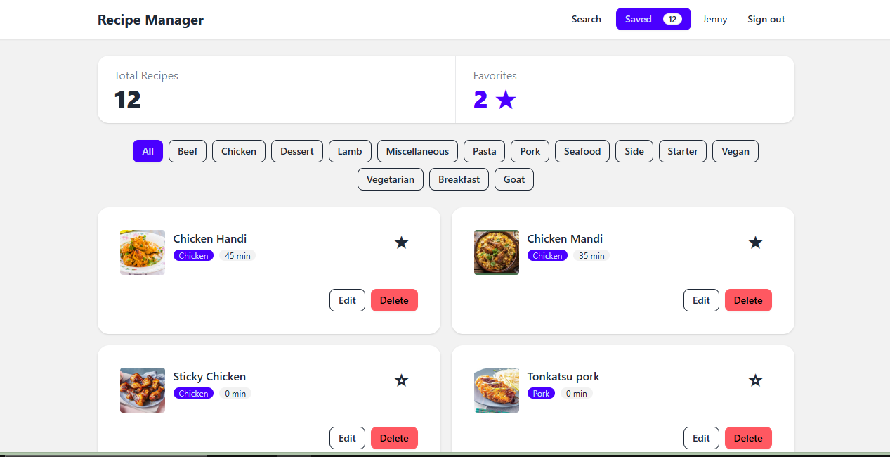

https://recipe-manager-ne7pjzdv9-toledo-01.vercel.app/



# Recipe Manager

A multi-page recipe app for searching TheMealDB, saving recipes in the browser,
and managing favorites, prep time, and notes.

## Tech Stack

- React and TypeScript
- Vite
- Tailwind CSS and DaisyUI
- React Router
- TanStack Query
- Vercel

## Run Locally

Requires Node.js and npm.

```bash
git clone https://github.com/Toledo-01/recipe-manager.git
cd recipe-manager
npm install
```

Create a `.env` file in the project root with:

```env
VITE_MEALDB_URL=https://www.themealdb.com/api/json/v1/1
```

Start the development server:

```bash
npm run dev
```

## Build

```bash
npm run build
npm run preview
```
